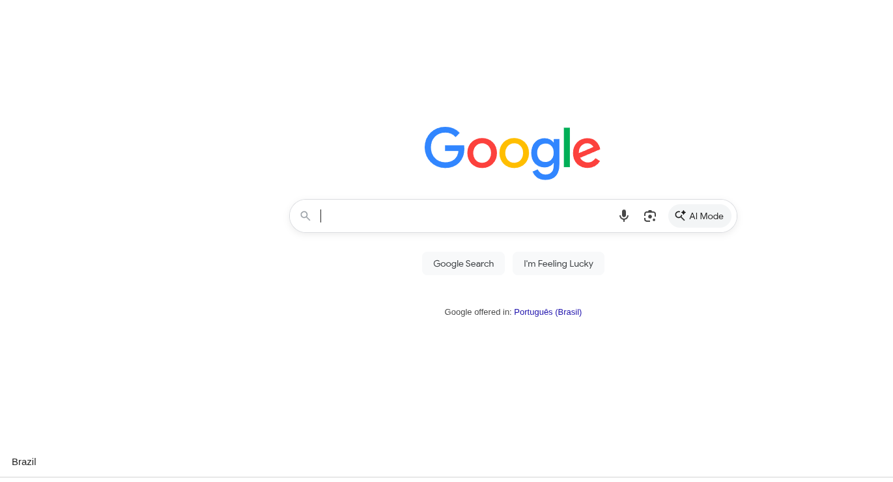
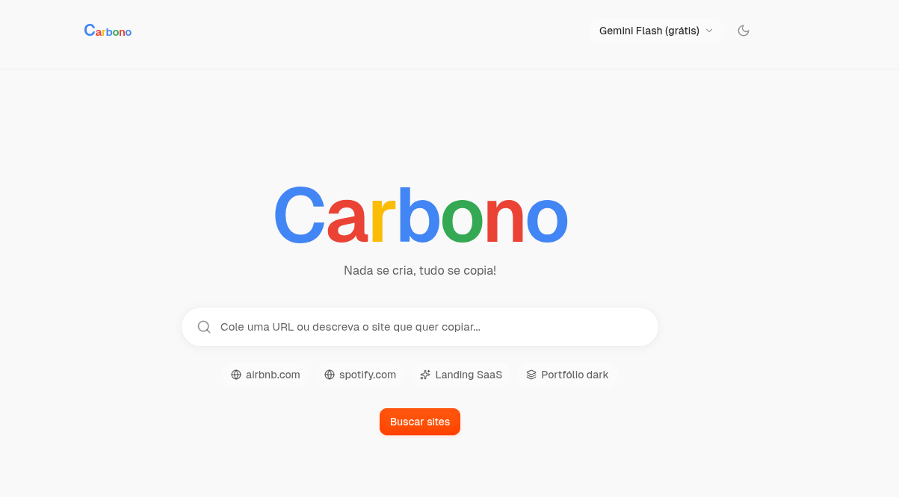

# Carbono

Builder de sites com IA baseado no firecrawl(open-lovable): cole a URL de um site para clonar o visual dele, ou descreva a ideia e o Carbono gera o site do zero. O código roda em um sandbox na nuvem (Vite + React), com preview ao vivo e export em ZIP.

## Prévia

| Site original | Site copiado |
|---|---|
|  |  |

## Recursos

- **Clonar por URL** — extração de conteúdo e estilo
- **Gerar do zero** — conversa com a IA escreve e edita o código 
- **Preview ao vivo** — sandbox E2B com hot-reload
- **Edição por conversa** — "deixa mais colorido", "troca o título" e a IA reaplica o código
- **Exportar ZIP** — baixa o projeto completo (sem `node_modules`)
- **Fallback automático de modelo** — se o modelo principal estourar cota (429/503), tenta o próximo sozinho

## Requisitos

- **Para container**: [Podman](https://podman.io) ou [Docker](https://docker.com)
- **Para Node.js local**: Node.js 18.18+ (recomendado 20+)
- Chaves de API (gratuitas no free tier):
  - **Firecrawl** — scraping: <https://firecrawl.dev>
  - **Google AI Studio** Gemini para uso gratuito ou outro provedor da sua preferencia
  - **E2B** E2b para uso gratuito  <https://e2b.dev> ou outro sandbox de sua preferencia

## Instalação

> **⚠️ Recomendação:** Este projeto é indicado para **uso local**. Caso não tenha experiência com as ferramentas listadas abaixo (Podman/Docker, Node.js, chaves de API), recomenda-se usar a **Opção 2 (Node.js local)**, que é mais simples.

### Opção 1 — Docker/Podman

Pré-requisito: [Podman](https://podman.io) (recomendado) ou [Docker](https://docker.com) instalado.

```bash
git clone <seu-repo> carbono
cd carbono
./setup.sh
```

O script detecta automaticamente Podman ou Docker, guia na configuração das chaves de API e inicia o container.

**Ou manualmente:**

```bash
git clone <seu-repo> carbono
cd carbono
cp .env.example .env.local  # edite com suas chaves
podman-compose up --build   # ou: docker compose up --build
```

Abra <http://localhost:3000>.

**Comandos úteis:**

```bash
podman-compose logs -f      # ver logs
podman-compose down         # parar
podman-compose restart      # reiniciar
```

### Opção 2 — Node.js local

```bash
git clone <seu-repo> carbono
cd carbono
npm install
cp .env.example .env.local
```

Edite `.env.local` (veja abaixo) e inicie:

```bash
npm run dev
```

Abra <http://localhost:3000>.

## Variáveis de ambiente (`.env.local`)

```bash
# Obrigatórias
FIRECRAWL_API_KEY=fc-...          # https://firecrawl.dev
GEMINI_API_KEY=...                # https://aistudio.google.com/app/apikey

# Sandbox (E2B não exige cartão — recomendado para uso local)
SANDBOX_PROVIDER=e2b
E2B_API_KEY=e2b_...               # https://e2b.dev

# Opcional: aplicação rápida de patches na IA
# MORPH_API_KEY=...
```

| Variável | Obrigatória | Para que serve |
|---|---|---|
| `FIRECRAWL_API_KEY` | Sim | Scrape/conteúdo das URLs |
| `GEMINI_API_KEY` | Sim* | Código gerado pela IA (padrão: Gemini) |
| `SANDBOX_PROVIDER` | Sim | `e2b` |
| `E2B_API_KEY` | Sim | Sandbox de execução |
| `OPENAI_API_KEY` / `ANTHROPIC_API_KEY` | Não | Modelos alternativos |
| `MORPH_API_KEY` | Não | Fast apply de patches |

\* Basta um provedor de IA (Gemini, OpenAI ou Anthropic).

## Como usar

1. **Clonar um site** — na home, cole a URL (`https://example.com`) e pressione o botão/seta. O Carbono extrai o visual e gera a réplica.
2. **Criar do zero** — descreva o que você quer no mesmo campo e o chat gera o projeto.
3. **Ajustar** — na tela de edição, converse com a IA ("muda a cor do botão para preto") e clique em **Apply** para ver o resultado no preview.
4. **Exportar** — botão **Download your Vite app as ZIP** baixa o projeto pronto para rodar (`npm install && npm run dev`).
5. **Sandbox** — botões de status/reinício ficam na barra do preview. Sandboxes E2B expiram após ~30 min; a UI cria outro automaticamente.

## Configuração

- **Modelo padrão**: `config/app.config.ts` → `defaultModel` (padrão `google/gemini-flash-latest`). `availableModels` lista os modelos que aparecem no seletor.
- **Provedor de sandbox**: `SANDBOX_PROVIDER=e2b` (único suportado).
- **Timeout do sandbox**: `config/app.config.ts` → `e2b.timeoutMinutes`.

## Scripts

```bash
npm run dev        # servidor de desenvolvimento (http://localhost:3000)
npm run build      # build de produção
npm run start      # inicia o build
npm run lint       # ESLint
npm run test:api   # testes de endpoint
npm run test:code  # testes de execução de código
```

### Container

```bash
./setup.sh                          # setup interativo + build + start
podman-compose up --build -d        # build e iniciar (detached)
podman-compose down                 # parar container
podman-compose logs -f              # acompanhar logs
podman-compose restart              # reiniciar
```


## Licença

MIT — ver `LICENSE` (herdado do projeto original open-lovable).
